# Fluid

An interactive study of water, light, and motion.

**[Experience Fluid](https://fluid-three-theta.vercel.app/)**

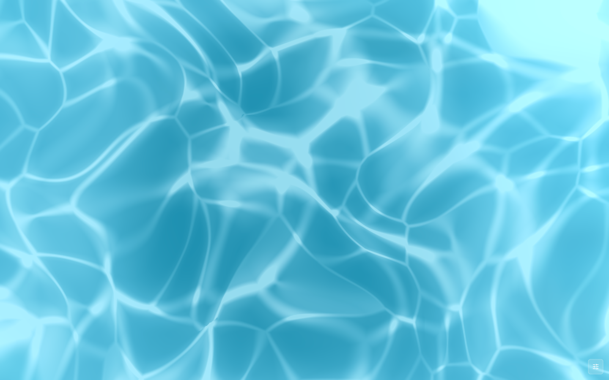

## About

Fluid is a little corner of the internet where you can play with water, change how it looks, or just watch it move. The whole screen is the water. Touch it and it responds, then slowly settles back to calm.

No goals. No rules. Just water, and a moment to play.

## Interaction

Drag across the surface to leave a wake behind you. Tap or click to drop a ripple. Ripples spread, run into each other, and fade on their own. Fluid works with a mouse on desktop and with a finger on a phone, where the view is reframed for portrait.

If you want to change the water, open the small panel in the corner (or press `C`). It has three controls: **Calm ↔ Restless**, **Low light ↔ Bright**, and a color picker. Each visit starts fresh.

<p>
  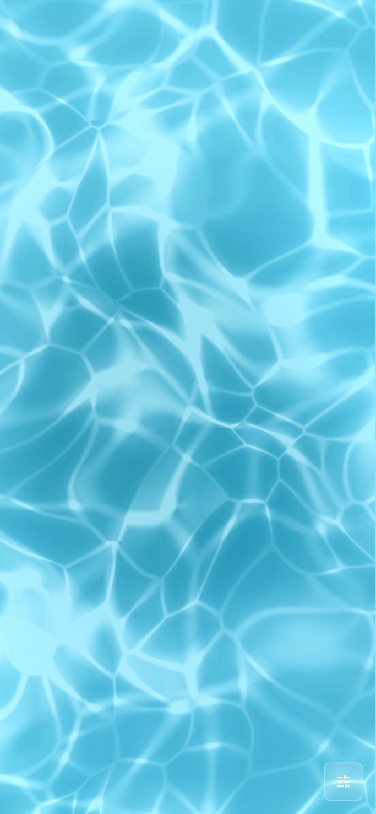
  &nbsp;&nbsp;
  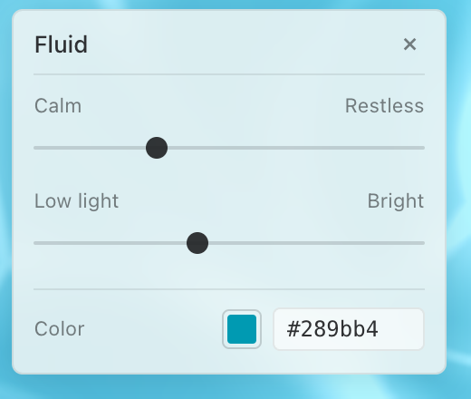
</p>

## From looking like water to feeling like water

The first version of Fluid looked beautiful, but interacting with it was surprisingly frustrating. Every frame was drawn from scratch, so ripples appeared and disappeared without affecting one another, and the water never quite felt responsive.

So I rebuilt the core around a GPU simulation. The water now has memory: movement leaves ripples that spread, overlap, and naturally settle. The look, palette, and lighting carried over; only the engine underneath changed. It was a reminder that visual polish and interaction quality aren't always the same thing.

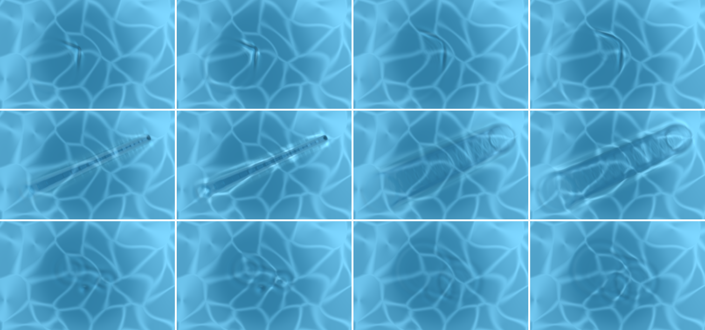

*Each stroke keeps spreading and fading after the pointer has moved on, something the original version couldn't do. The original is still available at `?legacy` for comparison. (https://fluid-three-theta.vercel.app/?legacy)*

## How it works

- **Responsive water.** The surface is a simulation running on the GPU, so it remembers every interaction. Ripples travel, interfere, and lose energy gradually instead of following a fixed animation.
- **Light and appearance.** Custom shaders recreate light moving through water: highlights, depth-based color, gentle refraction, and procedural caustic patterns that bend with the surface.
- **A little room to experiment.** A few simple controls let you adjust the water's movement, lighting, and color without exposing any technical settings.

**Built with:** Three.js, WebGL2, GLSL, Vite, and JavaScript.

## Run locally

Requires Node.js.

```bash
npm install
npm run dev       # start the Vite dev server
npm run build     # production build to dist/
npm run preview   # serve the production build locally
```

## Development history

<details>
<summary>The original visual phases, from reference photos to caustics</summary>

<br />

Fluid started from two photographs of pool water and was built up one visual layer at a time.

**Reference A** (cooler): deep cerulean, navy troughs, a sharp white caustic web.

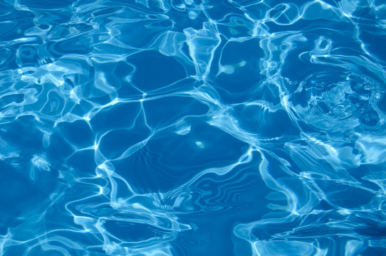

**Reference B** (brighter): turquoise and aqua with a denser, softer caustic mesh.

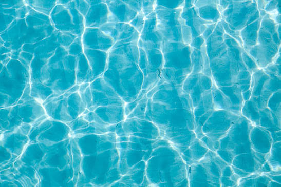

**Phase 1, basic surface.** Layered sine waves and a flat blue gradient. Calm, but it read like fabric.


**Phase 2, surface character.** Noise broke up the waves; procedural normals and height-based color made it more organic.

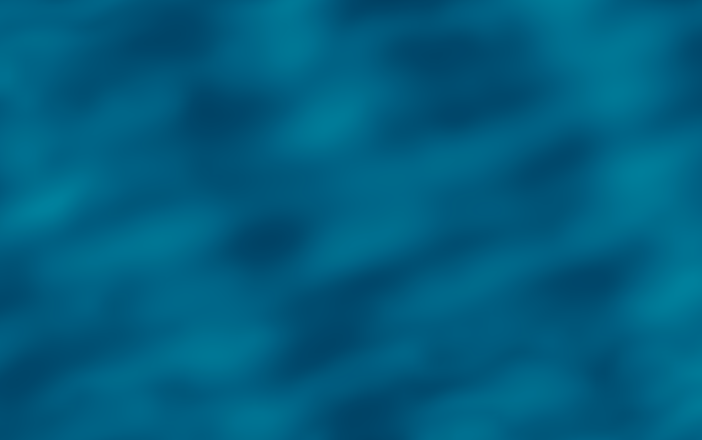

**Phase 3, lighting.** Directional light, specular highlights, and soft caustic-like streaks. More depth, but still a little like gel.

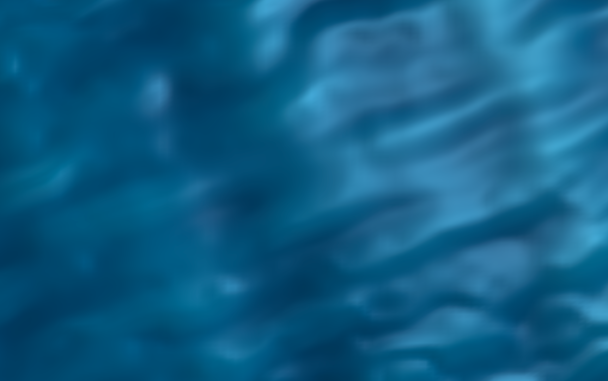

**Phase 4, Fresnel and optics.** Reflection, translucency, and subtle color distortion gave it a glassier, more liquid look.

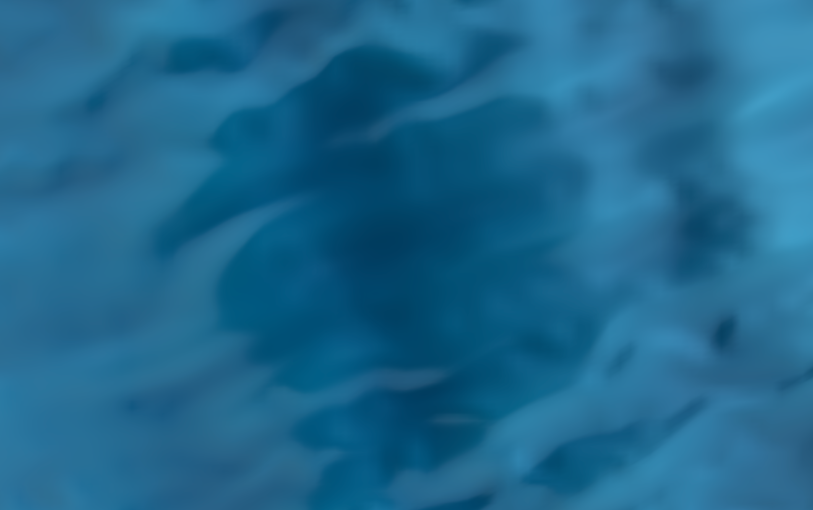

**Phases 5 and 6, interaction and controls.** Pointer wakes, tap ripples, and a first control panel, later reduced to the three controls that ship today.

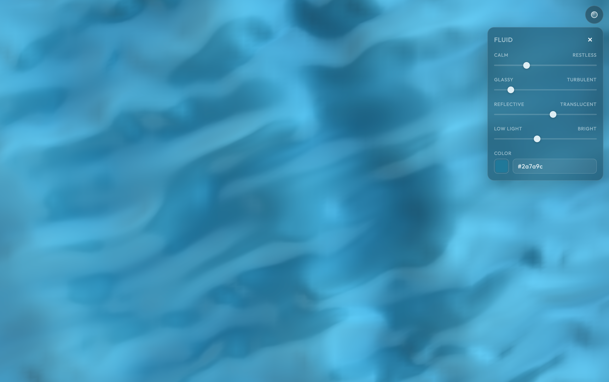

**Phase 6.5, caustic study.** A dedicated procedural caustic field produced the fine, branching light network seen in the references.

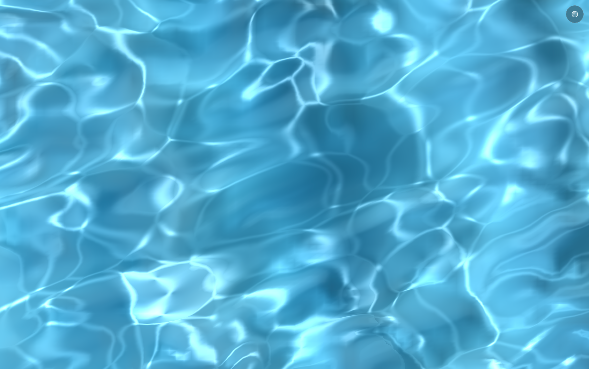

From here, the project moved to the GPU simulation described above.

</details>

## Documentation

[PROJECT.md](PROJECT.md) holds the full design notes: principles, shader and simulation architecture, profiling, the replacement roadmap, and the decision log.
